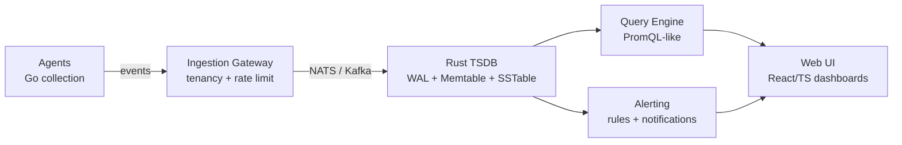

<div align="center">

# 🌀 Helix Observatory Platform

### A SOC-grade observability platform built from scratch

**Custom time-series database · Go ingestion · Rust storage · React dashboards · Kubernetes**

[](https://go.dev/)
[](https://www.rust-lang.org/)
[](https://www.typescriptlang.org/)
[](#components)
[](#honest-assessment)
[](LICENSE)

> Helix continues ApexGuard's event generation with full storage, analytics and
> querying. It replaces ClickHouse + Prometheus with a purpose-built TSDB tuned
> for SOC workloads.

</div>

---

## ✨ Highlights

- 🏗️ **Custom TSDB** — WAL + memtable + SSTable with compression and bloom filters, written in Rust.
- 🌐 **Multi-tenant from day one** — per-tenant quotas, isolation and metadata.
- 🔌 **Plugin architecture** for agents: health check → metrics extraction → tenant assignment.
- 🚦 **Backpressure + token-bucket rate limiting** to survive bursts.
- 📊 **Full stack** — collection → ingestion → storage → query → alerting → UI → deploy.
- ☸️ **Kubernetes-ready** with Helm charts.

## Architecture



## Components

| Component | Language | Lines | Status |
|---|---|---|---|
| 🦀 Rust Storage Engine | Rust | ~12 000 | WAL, memtable, SSTable, compression, bloom filters |
| 🐹 Go SDK | Go | ~7 000 | Client library |
| 📘 TypeScript SDK | TS | ~5 500 | Browser/Node client |
| 🌐 Web UI | TS/React | ~6 400 | Dashboards, query builder, alerting views |
| 📡 Ingestion Gateway | Go | ~3 000 | Tenancy, per-tenant rate limits, NATS streaming |
| 🤖 Event Agent | Go | ~2 000 | Collection with backpressure + plugin pipeline |
| 🛠️ CLI | Go | ~2 200 | Command-line tooling |
| 📜 API Definitions | Go | ~4 800 | gRPC + REST |
| ☸️ Helm Charts | YAML | ~16 700 | Kubernetes deployment |
| 📊 Benchmarks | Rust | — | Criterion perf suites |

**Total: ~34 000 lines** across Go, Rust and TypeScript.

## Project Structure

```
helix/
├── go.mod                  # Go module (helix.io)
├── agent/                  # Event collection agent (Go)
├── ingestion/              # Ingestion gateway (Go)
├── rust/                   # Rust workspace (TSDB + Query Engine)
├── api/                    # gRPC + REST API definitions
├── pkg/                    # Public SDK packages (Go, TS)
├── cli/                    # CLI tools
├── ui/                     # React/TypeScript Web UI
├── helm/                   # Kubernetes deployment charts
├── benches/                # Performance benchmarks
├── ci/                     # CI/CD pipeline configuration
├── alerting/               # Alerting rules + notifications
├── storage/                # Storage layer helpers
└── catalog/                # Catalog / metadata
```

## Quick Start

```bash
# Go
go mod download
go build ./...

# Rust storage engine
cd rust/helix-storage && cargo build --release

# Web UI
cd ui && npm install && npm run dev
```

## Honest Assessment

Helix is an **aspirational, early-alpha** project. The architecture and
foundations are solid, but there are significant implementation gaps:

- ✅ **Works:** agent collection with backpressure, plugin pipeline, rate limiting,
  memtable + WAL, basic query parsing, UI scaffolding, Helm charts.
- ⚠️ **Partial:** SSTable compaction, distributed query planning, alerting rule
  engine, full multi-tenancy enforcement.
- ❌ **Not yet:** production-grade replication, HA, complete PromQL parity,
  end-to-end integration tests.

I'd rather document the gaps than pretend they don't exist. Contributions and
feedback are welcome.

## Tech Stack

```text
Languages     Go · Rust · TypeScript · YAML
Messaging     NATS · Kafka
Storage       Custom TSDB (WAL, memtable, SSTable, bloom filters, compression)
Query         PromQL-like query language
Deploy        Kubernetes · Helm · Docker
CI            GitHub Actions
```

## Roadmap

- [ ] Complete SSTable compaction and tombstone handling
- [ ] Distributed query planning across shards
- [ ] Full PromQL parity for common functions
- [ ] Production-grade replication and HA
- [ ] End-to-end integration test suite
- [ ] Grafana-compatible API shim

## License

MIT — see [LICENSE](LICENSE).

---

<div align="center">
  <sub>Part of the FORGE ecosystem · Built by <a href="https://github.com/cokovali10-sketch">cokovali10-sketch</a></sub>
</div>
